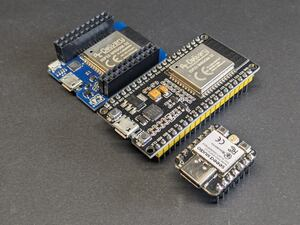
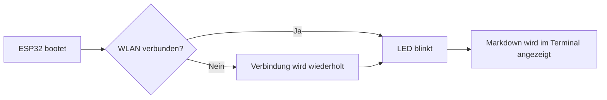

# Markdown im Terminal: ink

Ink Repo: https://github.com/borghei/ink

## Grafiken 



Diese README stellt das alte `glow`-Tool dem neuen `ink`-TUI-Tool gegenüber. Beide zeigen Markdown direkt im Terminal an. `ink` ist dabei die neue Oberfläche für die Markdown-Anzeige; Inhalte wie ESP32-Code und Mermaid-Diagramme bleiben als Beispiele erhalten.

| Altes Tool: `glow` | Neues Tool: `ink` |
|---|---|
| Klassischer Markdown-Renderer für das Terminal | TUI für eine interaktive Markdown-Anzeige |
| Aufruf: `glow esp32_flash_glow.md` | Aufruf: `ink esp32_flash_glow.md` |
| Gut für eine schnelle, statische Ausgabe | Gut zum Navigieren und Lesen längerer Markdown-Dateien |
| Zeigt Überschriften, Listen, Tabellen, Zitate und Code-Blöcke | Zeigt dieselben Markdown-Inhalte in einer TUI an |


## Mermaid



## Arduino-Code (ESP32)

```cpp
#include <WiFi.h>

const int LED = 2;

void setup() {
  pinMode(LED, OUTPUT);
  Serial.begin(115200);
  WiFi.begin("demo-netz", "demo-passwort");
  while (WiFi.status() != WL_CONNECTED) {
    digitalWrite(LED, HIGH);
    delay(80);
    digitalWrite(LED, LOW);
    delay(80);
  }
}

void loop() {
  for (int i = 0; i < 5; i++) {
    digitalWrite(LED, HIGH);
    delay(40);
    digitalWrite(LED, LOW);
    delay(40);
  }
  delay(800);
}
```

## Anzeigen

```bash
ink esp32_flash_glow.md
```

